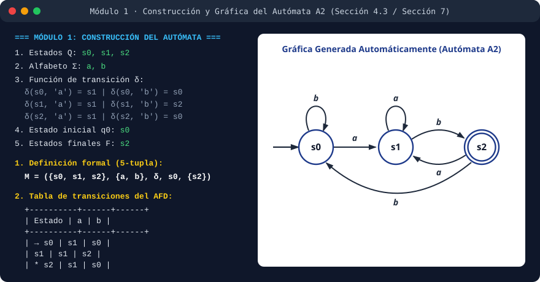
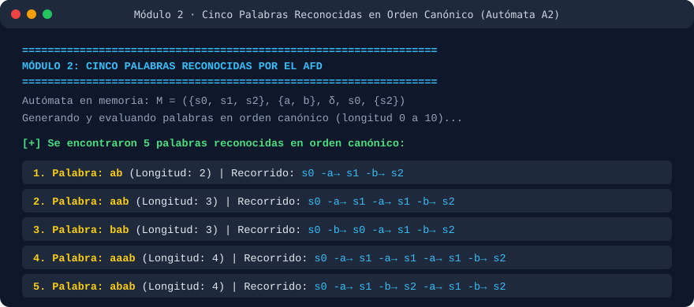
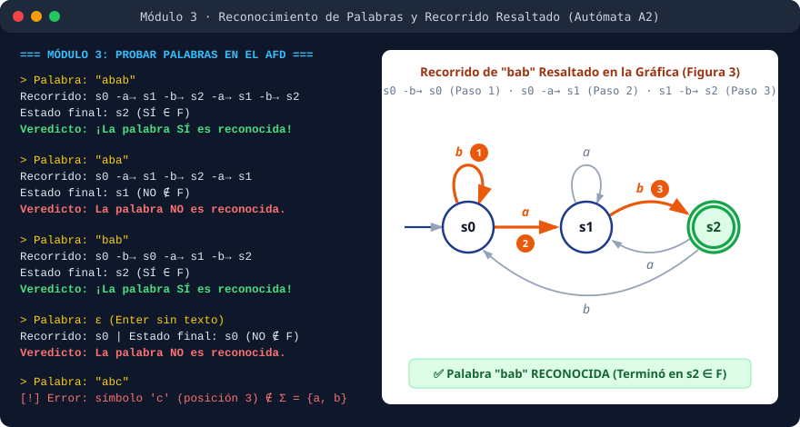

# Simulador de Autómatas Finitos Deterministas (AFD)

**Asignatura:** Estructuras Discretas  
**Proyecto:** Simulador de Autómatas Finitos (Módulos 1, 2 y 3)

---

## 1. Integrantes del Equipo

| Integrante | Usuario de GitHub |
| :--- | :--- |
| **Germán** | [@ElGermanDBg](https://github.com/ElGermanDBg) |
| **Darío** | [@Dario099](https://github.com/Dario099) |

*(Nota: Para consultar cómo mantener el repositorio actualizado entre los integrantes del equipo, revisar el archivo [GUIA_ACTUALIZACIONES_GIT.md](GUIA_ACTUALIZACIONES_GIT.md)).*

---

## 2. Lenguaje, Versión y Herramientas Utilizadas

- **Lenguaje de programación:** **Python 3.9 o superior**.
- **Librería de grafos:** `graphviz` (`pip install graphviz`), además de tener el software **Graphviz** instalado en el sistema operativo y agregado a la variable de entorno `PATH`.
- **Restricción cumplida:** **No** se utilizó ninguna librería que implemente autómatas (`automata-lib`, `pyformlang`, etc.). Toda la estructura de datos de la 5-tupla $M = (Q, \Sigma, \delta, q_0, F)$, la función de transición, el reconocimiento paso a paso y la generación en orden canónico fueron programados desde cero.

---

## 3. Instrucciones de Instalación y Ejecución

### Paso 1: Clonar o descargar el repositorio
```bash
git clone https://github.com/ElGermanDBg/simulador-automatas-finitos-afd.git
cd simulador-automatas-finitos-afd
```

### Paso 2: Instalar la librería Graphviz en Python
```bash
pip install graphviz
```
*(Adicionalmente, para renderizar y abrir automáticamente la imagen `.png` de la gráfica del autómata, asegúrese de tener instalado el software [Graphviz](https://graphviz.org/download/) en el sistema operativo y agregado al `PATH`).*

### Paso 3: Ejecutar el simulador
```bash
python simulador_afd.py
```

---

## 4. Ejemplo de Uso Paso a Paso (Autómata A2 - Sección 4.3 y Sección 7)

A continuación se muestra un ejemplo completo construyendo y probando el **Autómata A2**, el cual reconoce todas las palabras sobre $\Sigma = \{a, b\}$ que **terminan en `ab`**:

### 4.1 Construcción en el Módulo 1
1. **Estados ($Q$):** `s0, s1, s2`
2. **Alfabeto ($\Sigma$):** `a, b`
3. **Función de transición ($\delta$):**
   - $\delta(s0, a) = s1$
   - $\delta(s0, b) = s0$
   - $\delta(s1, a) = s1$
   - $\delta(s1, b) = s2$
   - $\delta(s2, a) = s1$
   - $\delta(s2, b) = s0$
4. **Estado inicial ($q_0$):** `s0`
5. **Estados finales ($F$):** `s2`

**Salida obtenida en el Módulo 1:**
```text
1. Definición formal (5-tupla):
   M = ({s0, s1, s2}, {a, b}, δ, s0, {s2})

2. Tabla de transiciones del AFD:
+----------+------+------+
| Estado   |  a   |  b   |
+----------+------+------+
| →  s0    |  s1  |  s0  |
|    s1    |  s1  |  s2  |
| *  s2    |  s1  |  s0  |
+----------+------+------+
```

### 4.2 Cinco palabras reconocidas en el Módulo 2
Al elegir la opción 2 en el menú principal, el programa genera palabras en orden canónico ($\varepsilon, a, b, aa, ab, ba, bb, aaa, aab\dots$) y muestra las primeras 5 aceptadas junto con su recorrido:
```text
1. Palabra: ab     | Longitud: 2 | Recorrido: s0 -a→ s1 -b→ s2
2. Palabra: aab    | Longitud: 3 | Recorrido: s0 -a→ s1 -a→ s1 -b→ s2
3. Palabra: bab    | Longitud: 3 | Recorrido: s0 -b→ s0 -a→ s1 -b→ s2
4. Palabra: aaab   | Longitud: 4 | Recorrido: s0 -a→ s1 -a→ s1 -a→ s1 -b→ s2
5. Palabra: abab   | Longitud: 4 | Recorrido: s0 -a→ s1 -b→ s2 -a→ s1 -b→ s2
```

### 4.3 Prueba de palabras en el Módulo 3
- **`abab`** $\to$ Recorrido: `s0 -a→ s1 -b→ s2 -a→ s1 -b→ s2` $\to$ Termina en `s2 ∈ F` $\to$ **SÍ es reconocida**.
- **`aba`** $\to$ Recorrido: `s0 -a→ s1 -b→ s2 -a→ s1` $\to$ Termina en `s1 ∉ F` $\to$ **NO es reconocida**.
- **`bab`** $\to$ Recorrido: `s0 -b→ s0 -a→ s1 -b→ s2` $\to$ Termina en `s2 ∈ F` $\to$ **SÍ es reconocida**.
- **Palabra vacía $\varepsilon$ (Enter sin texto)** $\to$ Recorrido: `s0` $\to$ Termina en `s0 ∉ F` $\to$ **NO es reconocida**.
- **`abc`** $\to$ Error detectado: el símbolo `'c'` en la **posición 3** no pertenece a $\Sigma = \{a, b\}$ $\to$ **NO es reconocida**.

---

## 5. Capturas de Pantalla de los Tres Módulos con el Autómata A2

### Módulo 1: Construcción, 5-Tupla, Tabla y Gráfica del Autómata A2


### Módulo 2: Cinco Palabras Reconocidas en Orden Canónico con el Autómata A2


### Módulo 3: Evaluación de Palabras con el Autómata A2


---

## 6. Estructura del Repositorio

- `simulador_afd.py`: Código fuente principal con la clase `Automata` y los 3 módulos del proyecto.
- `GUIA_ACTUALIZACIONES_GIT.md`: Guía paso a paso para que los integrantes del equipo actualicen y sincronicen el código con Git y GitHub.
- `capturas/`: Capturas de los tres módulos funcionando con el autómata A2.

---

## 7. Referencias y Declaración de Integridad Académica (Sección 10)

- **Documentación oficial de Python 3:** Consultada para el uso de `itertools.product` y estructuras de datos nativas (`list`, `dict`).
- **Documentación de Graphviz para Python (`graphviz.Digraph`):** Consultada para la definición de nodos (`circle`, `doublecircle`, `point`) y exportación en formato DOT.
